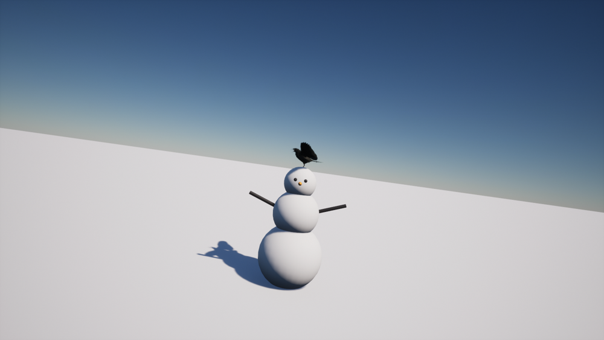

# UE52VFX Crow & Snowman — Unreal Engine 5.2

Ворона сидит на снеговике, время от времени каркает и улетает с карканьем, когда игрок подходит.
Всё настраивается в Blueprint, включая частоту карканья, громкость и затухание для каждой группы звуков.

[**Русский**](#русский) · [**English**](#english)



---

## Русский

### Что это

Плагин для Unreal Engine 5.2 из трёх C++ актёров, полностью открытых для Blueprint:

- `ACrowActor` (`BP_Crow`) — ворона: сидит, каркает, следит за игроком, пугается и улетает;
- `ASnowmanActor` (`BP_Snowman`) — снеговик из **одной** статической сетки, хранит точку присады для вороны;
- `ACrowTrigger` (`BP_CrowTrigger`) — сфера, которая пугает ворон(ы) при входе игрока.

Плюс готовая демо-карта `L_CrowDemo`.

### Требования

- Unreal Engine **5.2**
- Visual Studio 2022 с компонентом «Разработка игр на C++»
- Пакет **Animal Variety Pack** — ворона `SK_Crow`, 17 анимаций и 6 звуков карканья
  должны лежать в `/Game/AnimalVarietyPack/Crow/`

### Установка

**1. Скопировать плагин**

```
<ВашПроект>/Plugins/UE52VFX_Crow/
```

**2. Скопировать контент** — обязательно, иначе Blueprint'ы будут «битыми»

Пути `/Game/VFX/Crow/...` и `/Game/AnimalVarietyPack/Crow/...` зашиты внутри `.uasset`, поэтому файлы должны лежать ровно там:

| Что | Куда |
|---|---|
| `Content/VFX/Crow/` (включая `Demo/`) | `<Проект>/Content/VFX/Crow/` |
| `Content/AnimalVarietyPack/Crow/Audio/` | `<Проект>/Content/AnimalVarietyPack/Crow/Audio/` |

После копирования в `/Game/VFX/Crow/` должно быть:

```
BP_Crow.uasset
BP_CrowTrigger.uasset
BP_Snowman.uasset
ATN_Crow.uasset
M_Snowman.uasset  M_SnowGround.uasset  M_Carrot.uasset  M_Coal.uasset
Audio/S_Crow_WingFlap.uasset
Demo/L_CrowDemo.umap
```

**3. Включить плагин** — в `.uproject` или через **Edit → Plugins → UE52VFX Crow & Snowman**.

**4. Собрать**

```bat
"D:\Unreal Projects\UE_5.2\Engine\Build\BatchFiles\Build.bat" <ВашПроект>Editor Win64 Development -Project="<путь>\<Проект>.uproject"
```

После сборки появится `Plugins/UE52VFX_Crow/Binaries/Win64/UnrealEditor-UE52VFX.dll`.

### Почему модуль называется `UE52VFX`, а папка `UE52VFX_Crow`

Внутри `BP_Crow.uasset` родительский класс записан как `/Script/UE52VFX.CrowActor`.
Если назвать модуль иначе, Unreal не найдёт класс, и Blueprint станет «битым» —
его нельзя будет ни открыть, ни поставить на уровень. **Имя модуля обязано быть `UE52VFX`**, имя папки плагина любое.

### Демо-карта

`/Game/VFX/Crow/Demo/L_CrowDemo`

В ней уже расставлены: снеговик (`Demo_Snowman`, спавнит ворону при старте), `Demo_CrowTrigger`, земля, солнце, небо, туман и `PlayerStart` (примерно в 10 м от снеговика).
Откройте карту и нажмите **Play** — идите к снеговику: ворона каркает, ждёт задержку и улетает.

### Снеговик: одна статическая сетка

`ASnowmanActor` больше не собирается из шаров/конусов/цилиндров. В нём три компонента:

| Компонент | Назначение |
|---|---|
| `Root` | корень актёра |
| `SnowmanMesh` | **единственная** статическая сетка снеговика |
| `PerchPoint` | точка, где сидит ворона |

- Сетка назначается в поле **Snowman Mesh** (плюс `Snowman Material`, `Mesh Location Offset`, `Mesh Rotation Offset`, `Snowman Scale`).
- **`PerchPoint` теперь свободно перемещается.** Код никогда не перезаписывает его трансформ: двигайте его во вьюпорте Blueprint, в панели Details или в дереве компонентов у экземпляра на уровне. Точка сидения настраивается один раз и сохраняется.
- `Align Crow To Perch` — ворона садится с поворотом присады.

### Звук: три независимые группы

У вороны три аудиокомпонента, у каждой группы свои звуки, громкость и аттенюация:

| Группа | Компонент | Что играет | Настройки |
|---|---|---|---|
| Idle Caw | `CrowAudio` | карканье время от времени, пока сидит | `Idle Caw Sounds`, `Caw While Idle`, `Idle Caw Interval Min/Max`, `Idle Caw Volume`, `Idle Caw Attenuation` |
| Alarm | `AlarmAudio` | карканье в момент испуга | `Alarmed Sounds`, `Alarm Volume`, `Alarm Attenuation` |
| Take Off | `FlightAudio` | хлопки крыльев при взлёте | `Take Off Sounds`, `Take Off Volume`, `Take Off Attenuation` |

- Пауза между карканьями случайная в диапазоне `Idle Caw Interval Min..Max` (по умолчанию 3–9 с).
- `Sound Pitch Jitter` (0.08) слегка меняет тон каждого проигрывания, чтобы карканье не звучало одинаково.
- `Spatialize Sounds` выключается для плоского 2D-звука при отладке.
- В `BP_Crow` уже прописаны настоящие звуки вороны из Animal Variety Pack: `crow_01..06` (карканье) и `S_Crow_WingFlap` (крылья). Аттенюация — `ATN_Crow`.

### Почему ворона раньше летела боком

Меш `SK_Crow` смоделирован так, что смотрит в **+Y**, а актёр летит в **+X**, поэтому птица летела правым боком вперёд.
Теперь **`Auto Align Mesh Forward`** включён: поворот меша вычисляется по скелету (направление от корня к голове) при каждом `OnConstruction`/`BeginPlay`. Для `SK_Crow` получается ровно −90°, и ворона смотрит по направлению полёта, как бы меш ни был повёрнут в ассете.

- `Mesh Rotation Offset` добавляется поверх авто-выравнивания (pitch/roll применяются как есть) — используйте его, а не поворот самого компонента.
- Если нужен ручной режим — выключите `Auto Align Mesh Forward`.

### Что настраивается в `BP_Crow`

**Crow | Mesh**

| Параметр | Описание |
|---|---|
| `Crow Skeletal Mesh` | `SK_Crow` |
| `Crow Material Override` | материал для слота 0 (`M_Crow`) |
| `Mesh Relative Location` | смещение меша, чтобы лапы стояли на присаде |
| `Mesh Rotation Offset` | доп. поворот поверх авто-выравнивания |
| `Auto Align Mesh Forward` | авто-разворот меша по направлению полёта |
| `Crow Scale` | масштаб |

**Crow | Animation** — `Idle Animation`, `Take Off Animation`, `Fly Animation`, `Idle Play Rate`, `Fly Play Rate`, `Take Off Animation Time Scale`.

**Crow | Reaction** — `Use Proximity Trigger`, `Activation Radius`, `Trigger Delay`, `Only React To Player`, `Look At Player`, `Look At Radius`, `Look At Turn Speed`, `Draw Activation Radius`.

**Crow | Flight** — `Fly Away From Player`, `Direction Random Spread Deg`, `Take Off Vertical Speed`, `Fly Speed`, `Fly Acceleration`, `Climb Height`, `Climb Speed`, `Max Flight Time`, `Despawn Distance`, `Destroy After Flight`, `Disable Collision On Take Off`.

**Crow | State** — `State` (только чтение): `Idle → Alarmed → TakingOff → Flying → Gone`.

### Что настраивается в `BP_CrowTrigger`

`Trigger Radius`, `Delay`, `Only Player Pawn`, `Trigger Once`, `Auto Find Crows`, `Auto Find Radius`, `Crows`, `Draw Debug Radius`, `Triggered`.

### API (C++ / Blueprint)

```cpp
Crow->TriggerFlee(Instigator);   // испугать: каркнет, подождёт TriggerDelay и улетит
Crow->ResetToIdle();             // вернуть на присаду
Crow->GetCrowState();            // текущее состояние
Crow->GetDistanceToActivationTarget();
Crow->GetComputedMeshYawOffset(); // вычисленный поворот меша (для отладки)
```

События: `OnCrowAlarmed`, `OnCrowTakeOff`, `OnCrowFlyAway`, `OnTriggerFired`.

### Описания полей

У каждого свойства в C++ есть `ToolTip` на английском и русском, поэтому в Details панель подсказок объясняет параметр на обоих языках.

### Проверено

- `WinterHutEditor Win64 Development` — сборка без ошибок, `UnrealEditor-UE52VFX.dll` собран
- `BP_Crow`, `BP_CrowTrigger`, `BP_Snowman` загружаются и спавнятся (headless-проверка в редакторе)
- Авто-выравнивание меша для `SK_Crow` даёт −89.99° (ровно −90°)
- Демо-карта `L_CrowDemo` создана, содержит 8 актёров
- У `BP_Snowman` осталось ровно три компонента: `Root`, `SnowmanMesh`, `PerchPoint`

---

## English

### What it is

An Unreal Engine 5.2 plugin with three Blueprint-exposed C++ actors:

- `ACrowActor` (`BP_Crow`) — the bird: perches, caws periodically, watches the player and flies away when scared;
- `ASnowmanActor` (`BP_Snowman`) — a snowman made of **one** static mesh that owns the perch point;
- `ACrowTrigger` (`BP_CrowTrigger`) — a sphere that scares the crows when the player walks in.

A ready-to-play demo map (`L_CrowDemo`) is included.

### Requirements

- Unreal Engine **5.2**
- Visual Studio 2022 with the "Game development with C++" workload
- The **Animal Variety Pack** crow (`SK_Crow`, 17 animations, 6 caw sounds) at `/Game/AnimalVarietyPack/Crow/`

### Installation

**1. Copy the plugin**

```
<YourProject>/Plugins/UE52VFX_Crow/
```

**2. Copy the content** — required, otherwise the Blueprints are broken

The paths `/Game/VFX/Crow/...` and `/Game/AnimalVarietyPack/Crow/...` are baked into the assets, so they must land exactly there:

| What | Where |
|---|---|
| `Content/VFX/Crow/` (including `Demo/`) | `<Project>/Content/VFX/Crow/` |
| `Content/AnimalVarietyPack/Crow/Audio/` | `<Project>/Content/AnimalVarietyPack/Crow/Audio/` |

`/Game/VFX/Crow/` must contain:

```
BP_Crow.uasset
BP_CrowTrigger.uasset
BP_Snowman.uasset
ATN_Crow.uasset
M_Snowman.uasset  M_SnowGround.uasset  M_Carrot.uasset  M_Coal.uasset
Audio/S_Crow_WingFlap.uasset
Demo/L_CrowDemo.umap
```

**3. Enable the plugin** — in the `.uproject` or via **Edit → Plugins → UE52VFX Crow & Snowman**.

**4. Build**

```bat
"D:\Unreal Projects\UE_5.2\Engine\Build\BatchFiles\Build.bat" <YourProject>Editor Win64 Development -Project="<path>\<Project>.uproject"
```

After a successful build `Plugins/UE52VFX_Crow/Binaries/Win64/UnrealEditor-UE52VFX.dll` appears.

### Why the module is called `UE52VFX` and the folder `UE52VFX_Crow`

`BP_Crow.uasset` stores its parent class as `/Script/UE52VFX.CrowActor`. Use another module name and Unreal cannot resolve the class — the Blueprint becomes broken and can be neither opened nor placed. **The module name must be `UE52VFX`**; the plugin folder name is free.

### Demo map

`/Game/VFX/Crow/Demo/L_CrowDemo`

It already contains the snowman (`Demo_Snowman`, spawns the crow on start), `Demo_CrowTrigger`, a floor, sun, sky, fog and a `PlayerStart` about 10 m away.
Open it and press **Play** — walk to the snowman: the crow caws, waits for the delay and flies away.

### Snowman: a single static mesh

`ASnowmanActor` is no longer assembled from spheres, cones and cylinders. It has three components:

| Component | Purpose |
|---|---|
| `Root` | actor root |
| `SnowmanMesh` | the **only** static mesh of the snowman |
| `PerchPoint` | where the crow sits |

- Assign the mesh in **Snowman Mesh** (plus `Snowman Material`, `Mesh Location Offset`, `Mesh Rotation Offset`, `Snowman Scale`).
- **`PerchPoint` is freely movable now.** The code never overwrites its transform: drag it in the Blueprint viewport, in the details panel or in the components tree of a placed actor. The perch position is set once and kept.
- `Align Crow To Perch` makes the spawned crow copy the perch rotation.

### Audio: three independent groups

The crow has three audio components, each with its own sounds, volume and attenuation:

| Group | Component | Plays | Settings |
|---|---|---|---|
| Idle Caw | `CrowAudio` | periodic caws while perched | `Idle Caw Sounds`, `Caw While Idle`, `Idle Caw Interval Min/Max`, `Idle Caw Volume`, `Idle Caw Attenuation` |
| Alarm | `AlarmAudio` | caw the moment the bird is scared | `Alarmed Sounds`, `Alarm Volume`, `Alarm Attenuation` |
| Take Off | `FlightAudio` | wing flaps at take-off | `Take Off Sounds`, `Take Off Volume`, `Take Off Attenuation` |

- The pause between caws is random between `Idle Caw Interval Min` and `Max` (3–9 s by default).
- `Sound Pitch Jitter` (0.08) slightly varies the pitch of every playback so the caws do not sound identical.
- Turn `Spatialize Sounds` off for a flat 2D sound while debugging.
- `BP_Crow` already references the real crow sounds from the Animal Variety Pack: `crow_01..06` (caws) and `S_Crow_WingFlap` (wings), with `ATN_Crow` attenuation.

### Why the crow used to fly sideways

`SK_Crow` is authored facing **+Y** while the actor flies along **+X**, so the bird travelled right flank first.
`Auto Align Mesh Forward` is now on: the mesh yaw is computed from the skeleton (root to head direction) on every `OnConstruction`/`BeginPlay`. For `SK_Crow` it resolves to exactly −90°, so the crow faces its flight direction regardless of how the asset was authored.

- `Mesh Rotation Offset` is added on top of the automatic alignment (pitch/roll applied as-is) — use it instead of rotating the component itself.
- Need manual control? Turn `Auto Align Mesh Forward` off.

### Exposed on `BP_Crow`

**Crow | Mesh** — `Crow Skeletal Mesh`, `Crow Material Override`, `Mesh Relative Location`, `Mesh Rotation Offset`, `Auto Align Mesh Forward`, `Crow Scale`.

**Crow | Animation** — `Idle Animation`, `Take Off Animation`, `Fly Animation`, `Idle Play Rate`, `Fly Play Rate`, `Take Off Animation Time Scale`.

**Crow | Reaction** — `Use Proximity Trigger`, `Activation Radius`, `Trigger Delay`, `Only React To Player`, `Look At Player`, `Look At Radius`, `Look At Turn Speed`, `Draw Activation Radius`.

**Crow | Flight** — `Fly Away From Player`, `Direction Random Spread Deg`, `Take Off Vertical Speed`, `Fly Speed`, `Fly Acceleration`, `Climb Height`, `Climb Speed`, `Max Flight Time`, `Despawn Distance`, `Destroy After Flight`, `Disable Collision On Take Off`.

**Crow | State** — `State` (read only): `Idle → Alarmed → TakingOff → Flying → Gone`.

### Exposed on `BP_CrowTrigger`

`Trigger Radius`, `Delay`, `Only Player Pawn`, `Trigger Once`, `Auto Find Crows`, `Auto Find Radius`, `Crows`, `Draw Debug Radius`, `Triggered`.

### C++ / Blueprint API

```cpp
Crow->TriggerFlee(Instigator);    // scare it: caws, waits TriggerDelay, flies away
Crow->ResetToIdle();              // back to the perch
Crow->GetCrowState();             // current state
Crow->GetDistanceToActivationTarget();
Crow->GetComputedMeshYawOffset(); // computed mesh yaw (debug helper)
```

Events: `OnCrowAlarmed`, `OnCrowTakeOff`, `OnCrowFlyAway`, `OnTriggerFired`.

### Property tooltips

Every C++ property carries an English **and** Russian `ToolTip`, so the details panel explains each setting in both languages.

### Verified

- `WinterHutEditor Win64 Development` builds clean; `UnrealEditor-UE52VFX.dll` produced
- `BP_Crow`, `BP_CrowTrigger` and `BP_Snowman` load and spawn (headless editor check)
- Mesh auto-alignment for `SK_Crow` resolves to −89.99° (exactly −90°)
- The demo level `L_CrowDemo` exists and holds 8 actors
- `BP_Snowman` now has exactly three components: `Root`, `SnowmanMesh`, `PerchPoint`

---

## License

MIT. Free to use and modify.
